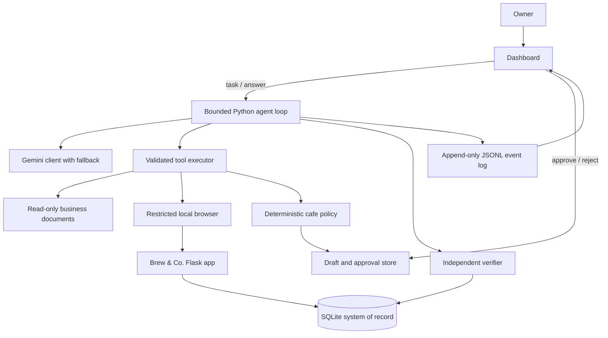

# Brew & Co. Autonomous Operations Assistant

Brew & Co. is a local cafe back-office prototype. An owner gives the worker a task in natural language. The worker reads inventory, purchase orders, supplier data, and local policy documents; deterministic Python evaluates any proposed order; the app records it; and an independent verifier checks the result. An order requiring approval pauses for an owner decision on the dashboard.

The business date follows the computer's local date by default. Set `BUSINESS_DATE=YYYY-MM-DD` only when a repeatable date is needed for a demo or test. Dates displayed in the app use `DD-MM-YYYY`.

## Setup on Windows / VS Code

Open a VS Code terminal in the project folder and run:

```powershell
python -m venv .venv
.venv\Scripts\Activate.ps1
python -m pip install -r requirements.txt
python -m playwright install chromium
Copy-Item .env.example .env
```

Edit `.env` and set `GEMINI_API_KEY` to your own key. Keep `.env` private; it is ignored by Git. The configured model order is `GEMINI_PRIMARY_MODEL`, followed by the comma-separated `GEMINI_FALLBACK_MODELS`. Do not run the probe or a live task until you are ready to spend API quota: the probe calls every configured model once, and a task can make several calls.

The checked-in example currently lists:

```text
GEMINI_PRIMARY_MODEL=gemini-3.8-flash
GEMINI_FALLBACK_MODELS=gemini-3.7-flash,gemini-3.6-flash,gemini-3.5-flash-lite
```

Probe history so far: `gemini-3.7-flash` passed one manual function-calling probe; `gemini-3.8-flash` returned a transient 504 in its one probe; the other listed models have not been probed. These are probe observations, not guarantees of availability.

## Reset and run the app

Reset the local demo database from the manual's seed data:

```powershell
python -m env.db.seed
```

Start the Flask app in one terminal:

```powershell
python -m env.server
```

Open [http://127.0.0.1:5000](http://127.0.0.1:5000). The dashboard shows current alerts and orders, starts worker tasks, collects clarification, displays pending approvals, and presents the event timeline and verification evidence. For an approval-required draft, review the item, supplier, amount, expected date, and reason codes before choosing **Approve & place order** or **Reject**.

To run a task from a second terminal instead of the dashboard, keep the server running and use:

```powershell
python scripts/run_agent.py "We're out of Assam tea — sort it out."
```

The CLI waits while you resolve clarification or approval on the dashboard. The dashboard is the recommended demo flow.

## Architecture



- **Gemini proposes the next tool call.** It does not execute tools or decide policy.
- **Python owns policy and writes.** Supplier eligibility, quantities, arrival dates, approval reasons, and hard blocks are computed deterministically from the database and current business date.
- **Tools are validated and bounded.** File reads stay in `env/data`; browser reads/writes stay on the local Brew & Co. origin and allow-listed pages.
- **Approval and verification are separate.** Owner approval is tied to the exact draft. The verifier re-reads SQLite and checks the linked purchase order, its fields, the draft status, and that exactly one order was added.
- **Task state and events are local.** SQLite stores the current run state; `runs/events.jsonl` records model calls, tool starts/results, pauses, and final verification. Browser screenshots are saved under `runs/browser_evidence/` and can be opened from the dashboard.

## Policy decisions and limitations

- The only business write is a purchase order. Expiry and stock pages are alerts; they do not make changes.
- A blocked or already-covered order is not submitted. The worker stops after an ambiguous write response and checks the system of record; it does not retry an uncertain write.
- The demo has no authentication and is intended for localhost only. Do not expose the server to a public network.
- Task execution is synchronous in the local web request. Large tasks and background workers are outside the project scope.
- A model response is not proof of completion. Successful order tasks must pass independent verification.
- A final isolated live E02 run on 12 Oct used only `gemini-3.6-flash`, with model requests sent serially at least 1.5 seconds apart. Gemini read inventory and open orders, checked deterministic supplier options, drafted 6 kg of TEA-ASM from GreenLeaf Tea Traders (S3) at ₹520/kg, and submitted the order through the local browser. The app returned PO-1009 (₹3,120; expected 14-10-2026), and the independent verifier passed all checks. Sanitized evidence and the receipt screenshot are in `docs/evidence/`.

## Important design decisions

- **A small Python loop instead of an agent framework:** the task flow is bounded and inspectable, so a short loop is easier to explain and audit than a framework or multi-agent setup.
- **Deterministic policy instead of model judgment:** the model can suggest a tool call, but Python computes supplier eligibility, quantities, delivery dates, approval reasons, and hard blocks from the current records and policy.
- **SQLite as the local system of record:** it keeps the prototype runnable without a hosted database and lets the verifier independently re-read order state.
- **Real local browser actions with Playwright:** the worker interacts with the same Flask pages the owner sees. Browser access is restricted to the local app and allow-listed pages.
- **Approval tied to a draft hash:** an owner approves the exact order proposal presented on the dashboard; a changed draft cannot reuse that approval.
- **Preserve Gemini function-call history:** each model turn is returned with its complete function-call part, thought signature, and call ID so the next request can continue the same reasoning turn correctly.
- **One purchase order per item:** this keeps approval, idempotency, and verification straightforward. Multi-item supplier grouping is outside this prototype.
- **Local event log and screenshots:** the dashboard can show what happened and what was verified without an external observability service.

## Assumptions

- The owner runs the prototype locally and is the only user; authentication and public deployment are out of scope.
- `BUSINESS_DATE` defaults to the computer's local date. It can be fixed for repeatable tests or demos.
- Seed data and documents are simulated business data from the project manual. Supplier notes are untrusted input, while deterministic policy and database status control decisions.
- The only consequential business write is placing a purchase order. Alerts and read-only tasks never write business state.
- A person is available to respond to clarification and approval prompts during a task.
- The student supplies and protects their own Gemini API key. Live model calls are intentionally deferred until final testing.

## Technologies and external components

- Python, Flask, SQLite, and Jinja templates for the local application and dashboard.
- Playwright with Chromium for browser-based worker actions and browser integration checks.
- Google's `google-genai` Python package for Gemini function calling; live calls require the user's API key and can consume quota.
- Pytest for offline unit, policy, integration, and scripted-agent checks.
- No hosted database, model framework, paid service, or non-Gemini model provider is required.

## What to build next

1. Rehearse E04 approval/rejection and one read-only scenario from a reset database; record a short demo without exposing `.env`.
2. Verify the README setup from a clean checkout and confirm `.env` and generated runtime data are absent from the submission.
3. Submit the repository and demo through the hiring form.

## Offline checks

Install dependencies above, then run the suite from the project root:

```powershell
python -m pytest -q -p no:cacheprovider --basetemp='.pytest-final'
```

The scripted model exercises E02, E04, E06, E11, E13, E16, and E17 without contacting Gemini. Browser integration tests use local Chromium and a temporary local Flask server. No tests should call Gemini unless a separate live test is explicitly authorized.

## Evaluation and remaining final checks

| Scenario / item | Current evidence | Final-stage action |
|---|---|---|
| E02 permitted order | Live Gemini 3.6 Flash run on 12 Oct: browser inventory and open-order reads, deterministic supplier check, permitted TEA-ASM draft, browser submission of PO-1009 for ₹3,120, and independent verifier passed all six checks. Sanitized evidence and receipt screenshot: `docs/evidence/e02-live-20261012.md` and `docs/evidence/e02-po-1009.png`. | Complete the final demo rehearsal |
| E04 approval | Scripted approve and reject paths; dashboard pause/resume | Demonstrate both owner outcomes from dashboard |
| E06 covered order | Scripted read-only path; no new PO | Confirm in final demo |
| E11 prompt injection | Scripted model reads fixture and selects active supplier | Demonstrate fixture and end state |
| E13 ambiguous submission | Scripted post-commit lost response; verifier finds one PO; no retry | Keep automated browser fault test in final suite |
| E16 / E17 generalization | Scripted deterministic expiry and open-order reports | Demonstrate one read-only task |
| Real model support | Gemini 3.6 Flash completed the final live E02 flow with serialized requests; 3.8 Flash returned transient HTTP 503s in a separate attempt. The loop preserves full response parts, thought signatures, and call IDs. | No further live model calls needed for E02 |
| Demo recording / fresh clone | Not completed | Complete before submission |

Do not treat scripted evidence as a real Gemini execution. Sanitized real-run evidence belongs in `docs/evidence/` after final testing.
