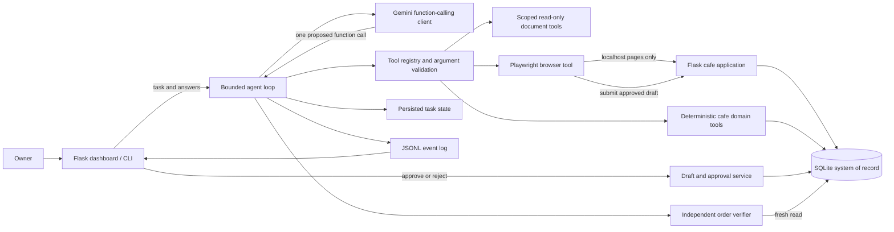

# Brew & Co. Autonomous Operations Assistant

Brew & Co. is a local proof of concept for an AI worker that completes a narrow but real business workflow: cafe inventory and purchasing operations. An owner describes an outcome in natural language. The worker inspects the simulated cafe’s pages and documents, chooses registered tools, applies deterministic purchasing policy, pauses for approval when required, performs an authorized purchase-order action through the browser, and verifies the resulting database records before reporting completion.

This project was built as a focused response to CentrAlign AI’s autonomous-worker engineering brief. It demonstrates a complete, inspectable task loop in a controlled environment; it is not a general-purpose agent or production deployment.

## Contents

- [What it does](#what-it-does)
- [Quick start](#quick-start)
- [Configuration](#configuration)
- [Architecture](#architecture)
- [Task lifecycle](#task-lifecycle)
- [Tools and permissions](#tools-and-permissions)
- [Purchasing policy](#purchasing-policy)
- [Data, state, and evidence](#data-state-and-evidence)
- [Web application](#web-application)
- [Testing](#testing)
- [Operational notes and troubleshooting](#operational-notes-and-troubleshooting)
- [Security and known limitations](#security-and-known-limitations)
- [Design decisions](#design-decisions)
- [Evaluation evidence](#evaluation-evidence)
- [Technology and external components](#technology-and-external-components)
- [Next steps](#next-steps)

## What it does

The owner can ask the worker to investigate a cafe operations task, for example:

> We’re out of Assam tea — sort it out.

The worker can use the local dashboard, inventory, supplier catalogue, and open purchase orders, as well as policy and supplier documents under `env/data/`. The Python domain layer computes permitted quantities, supplier eligibility, dates, policy blocks, and approval requirements. If the task is safe and permitted, the worker can create a draft and submit it using a real Playwright-controlled Chromium browser against this application. The verifier then independently reads SQLite to determine whether the order was actually recorded.

The application also provides owner-facing pages for inventory, suppliers, purchase orders, and manual purchase-order creation. The dashboard includes current stock and expiry alerts, open orders, worker tasks, approval cards, recent events, and saved browser evidence.

### Capabilities in this prototype

- Natural-language task input through the dashboard or CLI.
- Bounded model/tool loop with one proposed function call per step.
- Gemini function calling with ordered model fallback and bounded retries.
- Read-only access to scoped business documents and local application pages.
- Deterministic order calculations, supplier/status checks, and policy decisions.
- Human clarification and draft-specific owner approval.
- Browser-based purchase-order submission through the same form an owner uses.
- Independent database verification and an append-only run event log.
- Local task-state persistence so the dashboard can resume after approval or clarification.
- Business dates derived from the computer’s local date by default; displayed as `DD-MM-YYYY`.

## Quick start

These commands are for a Windows VS Code terminal opened at the project root. Use Python 3.10 or newer.

```powershell
python -m venv .venv
.venv\Scripts\Activate.ps1
python -m pip install -r requirements.txt
python -m playwright install chromium
Copy-Item .env.example .env
```

Edit `.env` and set the Gemini API key and model IDs as described in [Configuration](#configuration). Do not commit `.env` or share screenshots that expose it.

Reset or initialize the local demo database from the checked-in seed data:

```powershell
python -m env.db.seed
```

Start the web application in one terminal:

```powershell
python -m env.server
```

Open [http://127.0.0.1:5000](http://127.0.0.1:5000). Keep the server running while using the worker. Submit a task from the dashboard, or use the CLI from a second terminal:

```powershell
python scripts/run_agent.py "We're out of Assam tea — sort it out."
```

For approval-required work, inspect the pending draft on the dashboard and choose **Approve & place order** or **Reject**. The CLI waits for you to resolve the action in the browser. A task that is complete without an order should return a concise report without changing purchasing data.

> **Database reset warning:** the seed command resets the demo database, including locally created orders and task state. Save any evidence you need first.

## Configuration

The project reads simple `KEY=value` entries from `.env` and does not overwrite environment variables already set by the shell.

| Variable | Required | Purpose |
|---|---:|---|
| `GEMINI_API_KEY` | For live tasks | API key used by the official Google GenAI SDK. Keep it private. |
| `GEMINI_PRIMARY_MODEL` | For live tasks | First model ID attempted. Set this to a model available to your account. |
| `GEMINI_FALLBACK_MODELS` | Optional | Comma-separated model IDs tried in order after the primary is unavailable or incompatible. |
| `BUSINESS_DATE` | No | Optional `YYYY-MM-DD` override for repeatable demos/tests. If unset, the system’s local date is used. |

The checked-in `.env.example` currently contains:

```dotenv
GEMINI_API_KEY=your_api_key_here
GEMINI_PRIMARY_MODEL=gemini-3.8-flash
GEMINI_FALLBACK_MODELS=gemini-3.7-flash,gemini-3.6-flash,gemini-3.5-flash-lite
```

Model IDs and availability depend on the Google account and API service configuration. The application uses the primary followed by the configured fallback list. Transient server/network errors receive at most three attempts per model with short backoff; a quota response may honor a short `Retry-After` value, and unavailable models are skipped for the remainder of that task. Authentication errors stop with a configuration error. Calls are sequential; the worker does not fan out concurrent requests to configured models. Live calls consume API quota.

The final recorded live E02 rehearsal completed with `gemini-3.6-flash`. A separate attempt using `gemini-3.8-flash` encountered transient service errors. This is a record of those test runs, not a promise that a model will be available in future sessions. No live call is needed to run the offline test suite.

## Architecture

The design keeps model interpretation separate from business authority. The model selects from a small registered tool set; Python validates arguments and applies the rules that determine whether a business action is allowed.



### Main code areas

| Area | Responsibility |
|---|---|
| `agent/loop.py` | Starts and resumes tasks, asks the model for one next action, handles tool results, pauses for people, and stops at terminal states or a configured step limit. |
| `agent/gemini.py` | Loads model configuration, adapts the official SDK, parses function calls, preserves response history, and handles bounded retry/fallback behavior. |
| `agent/registry.py` | Defines the tools exposed to the model and binds them to Python handlers. |
| `agent/executor.py` | Rejects unknown tools or invalid arguments, bounds tool execution time, and records starts/results. |
| `agent/tools/` | Implements scoped file reads and local-browser reads/submission. |
| `env/domain.py` and `env/drafts.py` | Compute cafe-specific policy and draft/approval behavior using current business records. |
| `env/server.py` | Serves the Flask UI, task endpoints, dashboard data, estimate endpoint, and purchase-order form. |
| `env/db/` | Contains SQLite schema and seed command. |
| `agent/verify.py` | Re-reads the system of record and checks the result of a drafted order. |
| `agent/trace.py` | Appends sanitized execution and model events to JSONL. |

### Agent execution sequence

```mermaid
sequenceDiagram
    actor Owner
    participant UI as Dashboard or CLI
    participant Loop as Agent loop
    participant Gemini
    participant Tools as Validated tools
    participant Policy as Python policy / draft service
    participant Browser as Local Chromium
    participant DB as SQLite
    participant Verify as Independent verifier

    Owner->>UI: Natural-language task
    UI->>Loop: Start task
    Loop->>Gemini: Context + registered tool schemas
    Gemini-->>Loop: One function call or final response
    Loop->>Tools: Validate and execute proposed call
    Tools->>Policy: Inspect records / calculate permitted proposal
    Policy-->>Loop: Result, block, approval request, or clarification
    Loop-->>UI: Pause if owner action is required
    Owner->>UI: Clarification or draft-specific approval
    UI->>DB: Persist decision
    UI->>Loop: Resume saved task
    Loop->>Browser: Submit authorized draft through local form
    Browser->>DB: Application writes purchase order
    Browser-->>Loop: Receipt or uncertain response
    Loop->>Verify: Re-read draft and order state
    Verify->>DB: Read draft, linked PO, fields, and order count
    DB-->>Verify: Current persisted records
    Verify-->>Loop: Verified or failed checks
    Loop-->>UI: Final status, report, and evidence
```

The browser and Python domain layer do different jobs. The browser interacts with the UI and performs the permitted form submission. The domain layer computes and validates the proposed purchase; it does not ask the model to decide whether a supplier is eligible or whether an approval threshold has been crossed.

## Task lifecycle

Tasks have persisted state and may pause while a person responds. A typical order task follows this path:

1. **Understand:** the worker receives the owner’s request and uses the available pages/documents to gather relevant facts.
2. **Plan through tools:** Gemini proposes one registered tool call. Python checks the tool name and argument schema before execution.
3. **Evaluate:** Python reads current inventory, open orders, supplier catalogue and status, delivery constraints, and policy. It calculates an eligible proposal or a block.
4. **Draft:** the order is stored as a draft with the computed item, supplier, quantity, price, delivery date, decision, and reason codes.
5. **Pause when necessary:** the task waits for clarification or an owner decision. Approval applies to that exact draft; the approval record is checked before submission.
6. **Execute:** an authorized proposal is submitted via the local purchase-order page. The application checks the submitted values against the trusted draft.
7. **Verify:** the verifier reads SQLite independently and checks the linked order and expected state. An uncertain browser response triggers a fresh state check; an uncertain write is not blindly retried.
8. **Report:** the dashboard/CLI presents the terminal status, useful summary, verification checks, and available browser evidence.

The task runner uses statuses including `completed`, `waiting_for_user`, `waiting_for_approval`, `blocked`, `unknown_outcome`, `verification_failed`, and `step_limit`. Drafts have their own lifecycle (`ready`, `awaiting_approval`, `approved`, `rejected`, `blocked`, and `submitted`). A task status and a draft status are related but are not interchangeable.

## Tools and permissions

The model receives tool descriptions and JSON schemas, not Python handler access. The executor validates tool names and arguments and records tool starts and results.

| Tool | Access | What it does |
|---|---|---|
| `list_files` | Read-only | Lists files under the business documents directory. |
| `read_file` | Read-only | Reads a bounded UTF-8 document under the business documents directory. Document content is treated as untrusted data. |
| `read_dashboard` | Read-only | Reads the local dashboard. |
| `read_inventory` | Read-only | Reads inventory records from the local app page. |
| `read_suppliers` | Read-only | Reads supplier status and catalogue data. |
| `read_purchase_orders` | Read-only | Reads recorded purchase orders. |
| `submit_purchase_order` | Consequential write | Submits a ready or properly approved draft through the local app form. The app validates the posted fields against the stored draft. |

Python policy/draft functions are registered in the worker’s execution layer; they are deterministic code, not model-generated code. The browser tool only connects to the local Brew & Co. origin and applies a route allowlist. It does not browse arbitrary websites. Browser output and business documents are untrusted inputs and cannot alter the policy by including instructions.

## Purchasing policy

Purchasing decisions are based on the database, the policy configuration, and the system’s business date. The model can ask the domain layer to evaluate an order, but cannot set trusted prices or override supplier state or approval rules.

The policy data in `env/policy.json` currently defines open purchase-order statuses (`Placed`, `Confirmed`, and `In Transit`) and the expiry warning windows. The domain code and seed records supply other purchasing constraints such as item stock targets/maximums, pack sizes, supplier minimums, delivery days, and lead times. These values are checked before a draft can proceed.

| Situation | Result |
|---|---|
| An open purchase order already covers the need | Report the coverage; do not create another order. |
| Supplier is not active or does not catalogue the item | Do not use that supplier. |
| Proposed quantity/pack or delivery date violates constraints | Reject or block the proposal before submission. |
| An order crosses an approval rule | Save the draft and wait for the owner. |
| Owner rejects the pending draft | Mark the draft rejected; do not place the PO. |
| Draft is approved and unchanged | Allow the exact approved proposal to proceed. |
| A browser response is lost after a possible write | Query persisted records and verify; do not issue a blind duplicate submission. |

The exact decisions are implemented in Python and enforced again at the app/draft boundary. See `env/domain.py`, `env/drafts.py`, and the schema for the current source of truth.

## Data, state, and evidence

| Path | Contents |
|---|---|
| `env/db/schema.sql` | SQLite schema and constraints. |
| `env/db/seed.py` | Repeatable local seed/reset command. |
| `env/db/brew_demo.sqlite3` | Default local demo database created by the seed command; do not treat it as production data. |
| `env/policy.json` | Small policy settings used by deterministic domain logic. |
| `env/data/` | Simulated business policy, supplier, and inbox documents available to scoped file tools. |
| `runs/events.jsonl` | Append-only local task, model-call, tool, pause, and verification events. |
| `runs/browser_evidence/` | Browser screenshots referenced by relevant events/dashboard evidence. |
| `.env` | Local secret/configuration file; ignored by Git. |

The database stores business records and resumable task state (including serialized task conversation/tool history). The event log is a separate operational trace. Neither is a hosted service. Evidence should be reviewed before sharing; redact private task content or secrets if the environment has been customized.

The business date comes from the machine’s local date unless `BUSINESS_DATE=YYYY-MM-DD` is set. The override is useful for repeatable tests and demos. The UI displays dates as `DD-MM-YYYY`; stored dates use ISO format.

## Web application

The local Flask app provides:

| Route | Purpose |
|---|---|
| `/` | Dashboard, alert summaries, task form/history, approval cards, event timeline, and linked evidence. |
| `/inventory` | Seeded inventory and expiry dates. |
| `/suppliers` | Supplier status and catalogue information. |
| `/purchase-orders` | Recorded purchase-order history. |
| `/new-purchase-order` | Manual PO form and worker draft submission form. |
| `/order-estimate` | JSON estimate endpoint used by the form to show a selected item’s unit price and total. |
| `/tasks` | Starts a dashboard task. |
| `/tasks/<run_id>/answer` | Resumes a task after owner clarification. |
| `/drafts/<draft_id>/decision` | Records owner approval or rejection and resumes the task. |
| `/evidence/<filename>` | Serves a saved PNG screenshot from the configured evidence directory. |

The server binds to the local development address by default. It has no login, user accounts, CSRF defense suitable for public hosting, or multi-user authorization model. Keep it on localhost.

## Testing

Install dependencies and Chromium as shown in [Quick start](#quick-start), then run the offline suite from the project root:

```powershell
python -m pytest -q -p no:cacheprovider --basetemp='.pytest-final'
```

Tests use scripted/fake model providers and local fixtures; they do not call Gemini. Browser integration tests use Chromium and an isolated local Flask server/database. `--basetemp` keeps pytest’s temporary files in one named directory, while `-p no:cacheprovider` disables pytest’s `.pytest_cache` provider. Remove the named temporary directory when you are finished with it if you want a clean workspace.

For a focused approval, covered-order, and dashboard rehearsal:

```powershell
python -m pytest -q -p no:cacheprovider --basetemp='.pytest-focused' tests\test_agent_loop.py tests\test_dashboard_tasks.py -k "scripted_e04 or scripted_e06 or dashboard_approval"
```

That focused selection is useful during development; run the complete suite before relying on it as a final code check. Do not add live model tests to the default suite. A separate live-model run can consume quota and should only be done intentionally.

## Operational notes and troubleshooting

### The worker cannot reach the local app

- Start `python -m env.server` and keep that terminal running.
- Open `http://127.0.0.1:5000` and confirm the dashboard loads.
- Run `python -m env.db.seed` if the dashboard reports that the demo database is missing. This resets local data.
- The worker is intentionally restricted to the local Brew & Co. server.

### Chromium is missing

Run `python -m playwright install chromium` in the active virtual environment. The browser worker uses Chromium for actual local page interactions; offline unit tests may not require launching it, but browser integration tests do.

### Gemini configuration or availability error

- Check that `.env` exists and contains a valid `GEMINI_API_KEY` and primary model ID.
- Check spelling and account access for each configured model; fallback models are attempted in listed order.
- Authentication errors require fixing the key/configuration. Transient service or quota errors may exhaust the current task’s model list; the app reports failure rather than claiming that work completed.
- Use the scripted offline tests to develop without spending API quota.

### A task waits for approval or clarification

This is an expected paused state. Review the dashboard’s exact draft or question, respond there, and the saved task resumes. Approval is draft-specific and does not authorize a different set of order values.

### A task reports unknown outcome or verification failure

Check the dashboard, purchase-order page, database, and event timeline before attempting the task again. The worker avoids repeating a potentially committed order when it cannot establish the outcome.

## Security and known limitations

This is a single-user local proof of concept. Do not expose it to a public network or use real supplier credentials or live purchasing systems.

- **Local-only and unauthenticated:** no login, authorization roles, tenant isolation, or production web hardening.
- **Simulated business environment:** seed records and documents are sample data; placing an order writes only to the local SQLite demo application.
- **One consequential workflow:** the only external-looking business action is a purchase order inside the local app. There are no real suppliers, payment rails, ERP integrations, or email actions.
- **Narrow browser access:** Playwright is restricted to allow-listed pages on the local app, not arbitrary company sites or desktop apps.
- **Synchronous task execution:** dashboard task handling runs within a local web request. There is no durable distributed queue, scheduler, worker pool, or multi-process coordination guarantee.
- **Single-user SQLite:** suitable for a local demo, not concurrent enterprise workload or horizontal scaling.
- **Bounded autonomy:** one tool call per model response and a bounded loop; complex tasks can stop at the step limit or require the owner.
- **No learned persistent memory:** relevant task state is persisted for resume, but the project does not build a long-term organizational memory or learn from user feedback.
- **No broad recovery guarantee:** transient model failures have bounded retries/fallback; business-write ambiguity is verified from state and is not blindly retried. This does not cover every external failure mode.
- **No model guarantee:** language model output can be incomplete or wrong. Python validation, approval, and verification reduce risk but do not turn the prototype into a production-safe purchasing system.
- **Evidence/log privacy:** event records and task history may contain user-provided content. Treat local logs/screenshots as potentially sensitive.

## Design decisions

### Narrow workflow over broad simulation

The project focuses on a cafe operator workflow that can read real local pages, make a policy-backed decision, request approval, execute a browser action, and verify a result. This makes the autonomy claim observable and testable.

### A small Python loop rather than an agent framework

The core loop is explicit and bounded. This keeps transitions, tool calls, approvals, and stops inspectable and makes the model provider replaceable behind a small interface.

### The LLM proposes; deterministic code authorizes

Gemini helps interpret the task and choose a next tool. It does not have automatic function execution or direct database access. Python owns supplier eligibility, quantities, prices, date calculations, approval reasons, and hard blocks.

### Tool registry as a capability boundary

Only registered tools with declared argument schemas are visible to the model. The executor validates calls and applies timeouts. Separate file and browser tools restrict where the worker can read and write.

### Approval belongs to the draft

Approval is attached to the exact computed order proposal. The application checks the stored values and valid approval before submission, preventing a model or edited form from silently changing the approved order.

### Browser execution plus an independent verifier

The worker operates the same form an owner sees, making the action observable. Completion is based on a fresh read of the SQLite system of record, not the model’s final statement or a browser success message alone.

### Local system of record and audit trail

SQLite keeps the prototype easy to run and lets the verifier inspect committed state. A separate append-only JSONL log records model/tool activity, pauses, and outcomes without requiring a hosted observability stack.

### Sequential model fallback

Models are attempted in configured order, with bounded retries for transient failures. Sequential calls avoid unnecessary concurrent demand on the API and make fallback behavior easy to trace.

## Evaluation evidence

The repository includes the detailed rehearsal record in [`docs/evidence/pre-submission-checks-20261012.md`](docs/evidence/pre-submission-checks-20261012.md) and sanitized live-run details in [`docs/evidence/e02-live-20261012.md`](docs/evidence/e02-live-20261012.md).

| Scenario or check | Recorded result |
|---|---|
| E02 permitted live order | One isolated live run completed using Gemini 3.6 Flash and serialized requests. The worker ordered 6 kg of Assam tea (TEA-ASM) from GreenLeaf Tea Traders (S3), ₹520/kg, ₹3,120 total, with expected date 14-10-2026. It created PO-1009 and the independent verifier passed all six checks. A receipt screenshot is saved at `docs/evidence/e02-po-1009.png`. |
| E04 approval | Scripted offline rehearsal: approval resumes the task, places and verifies the PO; rejection leaves the seeded PO count unchanged. |
| E06 already-covered order | Scripted offline rehearsal: existing PO-1001 covers the requested caramel syrup; no new draft or PO is created. |
| Dashboard approval | Scripted offline rehearsal confirms the approved task resumes and the dashboard shows the verified result. |
| E11 prompt-injection fixture | Scripted run reads a supplier note containing hostile instructions and continues to follow deterministic supplier policy. |
| E13 ambiguous write response | Browser fault test simulates a lost response after commit; the verifier finds the committed PO and the worker does not submit a duplicate. |
| E16 / E17 read-only tasks | Scripted reports cover expiry and open-order information without a business write. |
| Clean checkout smoke check | A clone of the submitted `main` commit seeded successfully. Dashboard, inventory, suppliers, purchase orders, new-order form, and stylesheet returned HTTP 200. `.env.example` was present; `.env` was absent. |

The full offline suite was recorded at **92 passed, 1 skipped** in the final rehearsal. The skipped check is platform-dependent directory-symlink coverage on Windows. A later focused offline rehearsal recorded **4 passed** for E04 approval/rejection, E06 covered-order behavior, and dashboard approval. See the evidence note for exact scope. Scripted scenarios demonstrate application logic and are not live Gemini runs.

## Technology and external components

- **Python** for the agent runtime and domain policy.
- **Flask and Jinja** for the local dashboard and cafe pages.
- **SQLite** for demo business records, order drafts, approvals, and resumable task state.
- **Playwright with Chromium** for actual browser-based reads and local form submission.
- **Google GenAI Python SDK (`google-genai`)** for optional live Gemini function calling; requires the user’s API key and can consume quota.
- **Pytest** for unit, policy, browser, and scripted-agent checks.
- No hosted database, agent framework, non-Gemini model provider, or live supplier integration is required.

## Next steps

The implementation and clean-checkout evidence are recorded. The remaining submission-side work is to record and upload the short demo video, then submit the repository and video through the hiring form. The live-demo URL is optional according to the reviewed submission form. The form has not been filled by this project.
